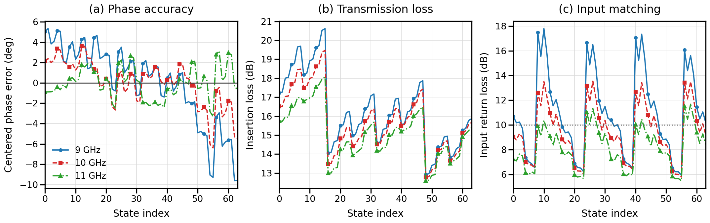

# 6-Bit X-Band CMOS Phase Shifter

Repository release: **v1.0.0**

This repository documents a 6-bit digital phase shifter designed and simulated
for X-band operation in a TSMC 180 nm CMOS environment. Six binary-weighted
phase cells provide 64 nominal states with a 5.625-degree least significant
bit.

The design, simulation, analysis, and repository were completed by
**Lam Thanh Dat**, under the supervision of **Dr. Hoang Manh Ha**, at Ho Chi
Minh City University of Technology (HCMUT), VNU-HCM.

The academic project was completed in December 2025. This standardized
v1.0.0 release was prepared in August 2026.

> **Reproducibility boundary:** this release includes the student-created
> Cadence OpenAccess library, with schematic views for all phase-shifter cells
> and the top-level layout view. It also reproduces the numerical analysis from
> three preserved 64-state Cadence exports. The licensed TSMC 180 nm PDK,
> device models, rule decks, ADE state, netlists, process corners, and original
> sweep configuration are not included. The source can therefore be inspected
> in a compatible Cadence environment, but the original simulations cannot be
> rerun without reconstructing the missing licensed environment and simulation
> setup.



## Main Results

All values below were independently recalculated from the native Cadence CSV
exports. The aggregate row combines 64 states at each of three sampled
frequencies: 9, 10, and 11 GHz.

| Frequency | Mean phase error | Phase RMS after offset removal | Mean insertion loss | Insertion-loss RMS | Mean input return loss | Minimum input return loss |
| --- | ---: | ---: | ---: | ---: | ---: | ---: |
| 9 GHz | -5.03 deg | 3.92 deg | 16.26 dB | 1.91 dB | 10.88 dB | 5.92 dB |
| 10 GHz | -2.17 deg | 2.28 deg | 15.72 dB | 1.66 dB | 9.46 dB | 5.78 dB |
| 11 GHz | +0.89 deg | 1.55 deg | 15.08 dB | 1.37 dB | 8.14 dB | 5.48 dB |
| Aggregate | -2.10 deg | 3.67 deg | 15.69 dB | 1.73 dB | 9.49 dB | 5.48 dB |

The simulated design achieves useful phase accuracy, particularly at the
10 GHz center frequency. Its principal limitations are high insertion loss,
amplitude variation between states, and input matching below 10 dB in many
configurations.

## Included Cadence Design

The complete student-created OpenAccess library is stored in
[`cadence/phase_shift`](cadence/phase_shift). It contains:

- schematic views for `bit5625`, `bit1125`, `bit225`, `bit45`, `bit90`, and
  `bit180`;
- the `nmos` switch-characterization schematic;
- the cascaded `phase_shift` top-level schematic;
- the `phase_shift` top-level layout; and
- Cadence-managed metadata, cell thumbnails, constraints, and the original
  design-library CSV exports.

The cell and view names are embedded in the OpenAccess hierarchy and have been
preserved exactly. See [`cadence/README.md`](cadence/README.md) for setup and
compatibility notes.

## Repository Structure

```text
.
|-- .github/workflows/       Continuous validation
|-- cadence/
|   |-- phase_shift/         Cadence OpenAccess design library
|   |-- cds.lib.example      Library-definition template
|   `-- SHA256SUMS           Design-source integrity manifest
|-- data/
|   |-- raw/                 Byte-preserved Cadence CSV exports and checksums
|   |-- reference/           Historically reported NMOS samples
|   `-- processed/           Generated tidy datasets
|-- docs/                    Technical report, method, setup, and integrity notes
|-- results/                 Recalculated metrics, figures, and design values
|-- scripts/                 Reproducible analysis and validation utilities
`-- tests/                   Data, metric, and source-integrity regression tests
```

The proprietary TSMC PDK, device models, Calibre rule decks, and Cadence
software are deliberately excluded. Obtain them only through an authorized
institutional or commercial license. See [NOTICE.md](NOTICE.md) and
[docs/x-band-phase-shifter-cadence-setup.md](docs/x-band-phase-shifter-cadence-setup.md).

The submitted Vietnamese report and presentation, redundant bitmap exports,
the workbook with the insertion-loss formula error, and other redundant
workbooks are not included. Their technical content is represented by the
English documentation, preserved raw CSV data, regenerated figures, and
OpenAccess design source in this repository.

## Validate the Repository

Python 3.10 or later is required.

```bash
python -m venv .venv
source .venv/bin/activate
python -m pip install -r requirements.txt
python scripts/verify_cadence_library.py
python scripts/verify_raw_data_checksums.py
python scripts/analyze_phase_shifter.py
python scripts/analyze_nmos_switch.py
python scripts/calculate_phase_cell_starting_values.py
python -m unittest discover -s tests -v
```

On Windows PowerShell, activate the environment with:

```powershell
.\.venv\Scripts\Activate.ps1
```

The analysis regenerates:

- `data/processed/phase_shifter_64_states.csv`
- `data/processed/nmos_switch_characterization.csv`
- `results/phase_shifter_performance_metrics.csv`
- `results/phase_shifter_performance_metrics.json`
- `results/phase_cell_starting_values.csv`
- four figures in `results/`, including a publication-quality performance overview

Run without Matplotlib by adding `--no-plots`.

For the pinned Python-package environment used to regenerate the tracked
figures, install `requirements-reproducibility.txt`. Exact PNG bytes can still
depend on the operating-system font and rendering stack.

## Documentation

- [Technical report (PDF)](docs/x-band-phase-shifter-technical-report.pdf)
- [Technical report (LaTeX source)](docs/x-band-phase-shifter-technical-report.tex)
- [Technical abstract (Markdown)](docs/x-band-phase-shifter-abstract.md)
- [Analysis methodology](docs/x-band-phase-shifter-analysis-methodology.md)
- [Data integrity review](docs/x-band-phase-shifter-data-integrity.md)
- [Cadence setup](docs/x-band-phase-shifter-cadence-setup.md)
- [Known limitations and uncertainties](docs/x-band-phase-shifter-design-limitations.md)

To rebuild the technical report with a standard TeX distribution, run:

```bash
latexmk -pdf -cd docs/x-band-phase-shifter-technical-report.tex
```

## Citation

Citation metadata are provided in [CITATION.cff](CITATION.cff).

## License

No open-source license has been granted. See [LICENSE](LICENSE) before reusing
the code, Cadence design source, data, report, or figures. `docs/IEEEtran.cls`
is third-party software under the LaTeX Project Public License; see
[NOTICE.md](NOTICE.md).
